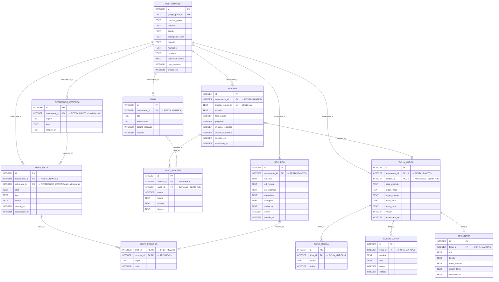

<!-- society-document -->
> **Estado:** vigente · diseño, no implementado. **Fecha de revisión:** 2026-10-12.
> **Ámbito / a quién obliga:** base de datos local (Room) de la app móvil en Kotlin, limitada a las cuatro pantallas del boceto que cubre el modelo entidad-relación: búsqueda del local, estudio del local, ficha del local y creación de una pieza.
> **Fuentes:** [modelo entidad-relación de la app móvil](Society_modelo_er_app_movil.md), revisión del 2026-10-12. Lo que procede de ese modelo va marcado como *ER*; lo que este documento añade va marcado como *propuesta* y hay que validarlo antes de implementar. Lo que no se ve en los bocetos sigue marcado como *no verificado*.
> **Índice único y autoridad:** [README raíz](../README.md).

# Society — Diagrama de estructura de datos de la app móvil (pantallas de alta y primera pieza)

## 1 Alcance

Este documento pasa el [modelo entidad-relación](Society_modelo_er_app_movil.md) al **modelo relacional** que usará Room sobre SQLite: tablas, columnas, tipos, nulos, claves primarias, foráneas y únicas, índices, valores por defecto, restricciones de dominio y qué pasa al borrar.

Cubre **las mismas cuatro pantallas** y las mismas doce entidades del ER, sin añadir ninguna:

| # | Pantalla | Tablas que usa |
|---|---|---|
| 1 | **Empezamos** · «Busca tu local en Google Maps» | RESTAURANTE, RECURSO |
| 2 | **Estudiando tu local** · paso 3 de 6 | ANALISIS, PASO_ANALISIS, CANAL |
| 3 | **Ficha del local** · «Ficha guardada en tu perfil» | FICHA_MARCA, TONO_MARCA, COLOR_MARCA, TIPOGRAFIA, CANAL |
| 4 | **Tu idea** · fotos de platos, del local y referencia estética | BRIEF_PIEZA, BRIEF_RECURSO, REFERENCIA_ESTETICA, RECURSO |

**Cómo se ha hecho el paso del ER al relacional:**

- Cada entidad del ER es una tabla con el mismo nombre. No quedan atributos multivaluados por resolver: las listas de la ficha (tono, colores y letras) ya son tablas propias en el ER.
- Las relaciones 1:N y 0..1:N se resuelven con una clave foránea en el lado N.
- La relación 1:0..1 entre RESTAURANTE y FICHA_MARCA se resuelve con una foránea única en FICHA_MARCA. La 0..1:0..1 entre ANALISIS y FICHA_MARCA, con una foránea única que admite nulos.
- La relación N:M entre BRIEF_PIEZA y RECURSO es la tabla BRIEF_RECURSO, con clave primaria compuesta por las dos foráneas.

**Contradicción registrada.** Sigue abierta la del [ER §1](Society_modelo_er_app_movil.md#1-alcance): el README (§8) propone la interfaz como web y este diseño es para una app en Kotlin con Room. Hasta que se registre el cambio en el README §14, este documento vale solo para la opción móvil.

## 2 Diagrama

Cada flecha va etiquetada con la columna foránea que la implementa, y cada foránea indica la columna a la que apunta.

## 3 Esquema relacional

Notación: **negrita** = clave primaria; *cursiva* = clave foránea; «único» = clave alternativa.

- RESTAURANTE (**id**, google_place_id, nombre_google, nombre, apodo, descripcion_corta, direccion, municipio, provincia, valoracion_media, num_resenas, creado_en) · único: google_place_id
- RECURSO (**id**, *restaurante_id*, uri_local, url_remota, procedencia, naturaleza, categoria, atribucion, orden, creado_en)
- CANAL (**id**, *restaurante_id*, tipo, identificador, acepta_reservas, editado)
- ANALISIS (**id**, *restaurante_id*, trabajo_remoto_id, estado, total_pasos, progreso, minutos_restantes, avisar_al_terminar, iniciado_en, terminado_en) · único: trabajo_remoto_id
- PASO_ANALISIS (**id**, *analisis_id*, *canal_id*, orden, fuente, estado, detalle) · único: (analisis_id, orden)
- FICHA_MARCA (**id**, *restaurante_id*, *analisis_id*, frase_ejemplo, origen_frase, origen_colores, unico_local, unico_carta, version, actualizada_en) · único: restaurante_id; analisis_id
- TONO_MARCA (**id**, *ficha_id*, palabra, orden)
- COLOR_MARCA (**id**, *ficha_id*, nombre, hex, orden, editado)
- TIPOGRAFIA (**id**, *ficha_id*, rol, familia, texto_muestra, origen_texto, coincidencia) · único: (ficha_id, rol)
- BRIEF_PIEZA (**id**, *restaurante_id*, *referencia_id*, idea, tipo, estado, creado_en, actualizado_en)
- BRIEF_RECURSO (***brief_id***, ***recurso_id***, papel, orden)
- REFERENCIA_ESTETICA (**id**, *restaurante_id*, origen, titulo, imagen_uri)

## 4 Tablas

Convenciones para todas las tablas (*ER*): claves primarias `INTEGER` autogeneradas, fechas como `INTEGER` en milisegundos desde época, booleanos como `INTEGER` 0/1 y enumerados como `TEXT`. Este documento añade (*propuesta*) que cada booleano y cada enumerado lleve su restricción de valores permitidos, y que ninguna columna numérica de conteo admita negativos.

### 4.1 RESTAURANTE · pantallas 1 y 3

| Columna | Tipo | Nulo | Clave | Por defecto | Restricción y origen |
|---|---|---|---|---|---|
| `id` | INTEGER | no | PK | autogenerado | *ER* |
| `google_place_id` | TEXT | no | único | — | *ER* |
| `nombre_google` | TEXT | sí | | — | *ER* |
| `nombre` | TEXT | no | | — | *ER*. *Propuesta:* al crear el registro toma el valor del título del resultado |
| `apodo` | TEXT | sí | | — | *ER* |
| `descripcion_corta` | TEXT | sí | | — | *ER* |
| `direccion`, `municipio`, `provincia` | TEXT | no | | — | *ER* |
| `valoracion_media` | REAL | sí | | — | *ER*, caché de Google. *Propuesta:* entre 0 y 5 |
| `num_resenas` | INTEGER | sí | | — | *ER*, caché de Google. *Propuesta:* 0 o más |
| `creado_en` | INTEGER | no | | — | *ER* |

### 4.2 RECURSO · pantallas 1 y 4

| Columna | Tipo | Nulo | Clave | Por defecto | Restricción y origen |
|---|---|---|---|---|---|
| `id` | INTEGER | no | PK | autogenerado | *ER* |
| `restaurante_id` | INTEGER | no | FK | — | *ER* |
| `uri_local` | TEXT | sí | | — | *ER*: ruta en el almacenamiento interno, nunca la imagen |
| `url_remota` | TEXT | sí | | — | *ER* |
| `procedencia` | TEXT | no | | — | *ER*: `GOOGLE_MAPS`, `GALERIA`, `CAMARA`, `WEB` o `INSTAGRAM` |
| `naturaleza` | TEXT | no | | — | *ER*: `REAL`, `GENERADO` o `EXTERNO`; las de Google entran como `EXTERNO` |
| `categoria` | TEXT | no | | `SIN_CLASIFICAR` | *ER*: `PLATO`, `LOCAL` o `SIN_CLASIFICAR`. El valor por defecto es *propuesta* |
| `atribucion` | TEXT | sí | | — | *ER*. *Propuesta:* obligatoria cuando `procedencia = GOOGLE_MAPS`, porque Places exige mostrar el autor |
| `orden` | INTEGER | no | | 0 | *ER*. Valor por defecto y no negativo: *propuesta* |
| `creado_en` | INTEGER | no | | — | *ER* |

*Propuesta* a nivel de tabla: al menos una de `uri_local` y `url_remota` no es nula. Una foto de Google puede tener solo la URL hasta que se descarga.

### 4.3 CANAL · pantallas 2 y 3

| Columna | Tipo | Nulo | Clave | Por defecto | Restricción y origen |
|---|---|---|---|---|---|
| `id` | INTEGER | no | PK | autogenerado | *ER* |
| `restaurante_id` | INTEGER | no | FK | — | *ER* |
| `tipo` | TEXT | no | | — | *ER*: `INSTAGRAM`, `TIKTOK`, `WEB` o `WHATSAPP` |
| `identificador` | TEXT | no | | — | *ER*: `@usuario`, dominio o teléfono |
| `acepta_reservas` | INTEGER | no | | 0 | *ER*: booleano 0/1 |
| `editado` | INTEGER | no | | 0 | *ER*: booleano 0/1 |

*Propuesta* a nivel de tabla: única por (`restaurante_id`, `tipo`, `identificador`), para que repetir el análisis no duplique un perfil.

La línea «Reservas: WhatsApp y formulario web» sigue sin columna propia (*ER*): se calcula con los canales que tienen `acepta_reservas = 1`.

### 4.4 ANALISIS · pantalla 2

| Columna | Tipo | Nulo | Clave | Por defecto | Restricción y origen |
|---|---|---|---|---|---|
| `id` | INTEGER | no | PK | autogenerado | *ER* |
| `restaurante_id` | INTEGER | no | FK | — | *ER* |
| `trabajo_remoto_id` | TEXT | sí | único | — | *ER* la marca como única. Que admita nulo es *propuesta*: el registro se guarda antes de enviar el trabajo y el identificador llega después, como pide el README §8 («persistir intención antes de enviar e ID remoto al recibirlo»). SQLite permite varios nulos en una columna única |
| `estado` | TEXT | no | | `EN_CURSO` | *ER*: `EN_CURSO`, `TERMINADO`, `ERROR` o `CANCELADO` |
| `total_pasos` | INTEGER | no | | — | *ER*. *Propuesta:* mayor que 0 (el boceto muestra 6) |
| `progreso` | INTEGER | no | | 0 | *ER*: de 0 a 100 |
| `minutos_restantes` | INTEGER | sí | | — | *ER*. *Propuesta:* 0 o más |
| `avisar_al_terminar` | INTEGER | no | | 0 | *ER*: booleano 0/1 |
| `iniciado_en` | INTEGER | no | | — | *ER* |
| `terminado_en` | INTEGER | sí | | — | *ER*. *Propuesta:* obligatorio cuando el estado no es `EN_CURSO` y nunca anterior a `iniciado_en` |

*Propuesta* a nivel de tabla: **un solo análisis `EN_CURSO` por restaurante**. Es la regla del ER §3.4 («al volver a abrir la app se consulta su estado y no se lanza otro») llevada a la base de datos.

### 4.5 PASO_ANALISIS · pantalla 2

| Columna | Tipo | Nulo | Clave | Por defecto | Restricción y origen |
|---|---|---|---|---|---|
| `id` | INTEGER | no | PK | autogenerado | *ER* |
| `analisis_id` | INTEGER | no | FK | — | *ER* |
| `canal_id` | INTEGER | sí | FK | — | *ER*: nulo si el paso no lee un canal |
| `orden` | INTEGER | no | | — | *ER*. *Propuesta:* 1 o más |
| `fuente` | TEXT | no | | — | *ER*: `GOOGLE_MAPS`, `INSTAGRAM`, `WEB`, `TIKTOK` o `COLORES_Y_LETRAS`. Falta el sexto paso (*no verificado*) |
| `estado` | TEXT | no | | `PENDIENTE` | *ER*: `PENDIENTE`, `EN_CURSO`, `HECHO`, `ERROR` u `OMITIDO` |
| `detalle` | TEXT | sí | | — | *ER* |

Única por (`analisis_id`, `orden`) (*ER* §5). Que `orden` no supere `total_pasos` del análisis no se puede expresar como restricción de una sola tabla: se comprueba en la app.

### 4.6 FICHA_MARCA · pantalla 3

| Columna | Tipo | Nulo | Clave | Por defecto | Restricción y origen |
|---|---|---|---|---|---|
| `id` | INTEGER | no | PK | autogenerado | *ER* |
| `restaurante_id` | INTEGER | no | FK, único | — | *ER*: relación 1:0..1 |
| `analisis_id` | INTEGER | sí | FK, único | — | *ER* (FK). Que sea única es *propuesta*: así se cumple el 0..1:0..1 del ER |
| `frase_ejemplo`, `origen_frase` | TEXT | sí | | — | *ER* |
| `origen_colores` | TEXT | sí | | — | *ER*: una sola frase para toda la paleta |
| `unico_local`, `unico_carta` | TEXT | sí | | — | *ER* |
| `version` | INTEGER | no | | 1 | *ER*: sube con cada edición. *Propuesta:* 1 o más |
| `actualizada_en` | INTEGER | no | | — | *ER* |

### 4.7 TONO_MARCA, COLOR_MARCA y TIPOGRAFIA · pantalla 3

**TONO_MARCA**

| Columna | Tipo | Nulo | Clave | Por defecto | Restricción y origen |
|---|---|---|---|---|---|
| `id` | INTEGER | no | PK | autogenerado | *ER* |
| `ficha_id` | INTEGER | no | FK | — | *ER* |
| `palabra` | TEXT | no | | — | *ER*: Cercano, Tradicional, Apetitoso… |
| `orden` | INTEGER | no | | — | *ER* |

*Propuesta:* única por (`ficha_id`, `orden`).

**COLOR_MARCA**

| Columna | Tipo | Nulo | Clave | Por defecto | Restricción y origen |
|---|---|---|---|---|---|
| `id` | INTEGER | no | PK | autogenerado | *ER* |
| `ficha_id` | INTEGER | no | FK | — | *ER* |
| `nombre` | TEXT | no | | — | *ER*: Dorado, Azul rótulo, Ladrillo… |
| `hex` | TEXT | no | | — | *ER*. *Propuesta:* formato `#RRGGBB` |
| `orden` | INTEGER | no | | — | *ER* |
| `editado` | INTEGER | no | | 0 | *ER*: booleano 0/1 |

*Propuesta:* única por (`ficha_id`, `orden`).

**TIPOGRAFIA**

| Columna | Tipo | Nulo | Clave | Por defecto | Restricción y origen |
|---|---|---|---|---|---|
| `id` | INTEGER | no | PK | autogenerado | *ER* |
| `ficha_id` | INTEGER | no | FK | — | *ER* |
| `rol` | TEXT | no | | — | *ER*: `TITULOS`, `TEXTOS` o `ROTULO` |
| `familia` | TEXT | sí | | — | *ER*: el boceto muestra la letra, no su nombre |
| `texto_muestra` | TEXT | no | | — | *ER*. Que no admita nulo es *propuesta*: es lo que se pinta en la ficha |
| `origen_texto` | TEXT | sí | | — | *ER* |
| `coincidencia` | TEXT | sí | | — | *ER*: `EXACTA` o `PARECIDA`. Si siempre se conoce está *no verificado*; mientras tanto admite nulo |

Única por (`ficha_id`, `rol`) (*ER* §5).

### 4.8 BRIEF_PIEZA, BRIEF_RECURSO y REFERENCIA_ESTETICA · pantalla 4

**BRIEF_PIEZA**

| Columna | Tipo | Nulo | Clave | Por defecto | Restricción y origen |
|---|---|---|---|---|---|
| `id` | INTEGER | no | PK | autogenerado | *ER* |
| `restaurante_id` | INTEGER | no | FK | — | *ER* |
| `referencia_id` | INTEGER | sí | FK | — | *ER*: como mucho una referencia por brief |
| `idea` | TEXT | sí | | — | *ER*. *Propuesta:* puede estar vacía en `BORRADOR` y es obligatoria en `ENVIADO` |
| `tipo` | TEXT | sí | | — | *ER*: `PLATO_ESTRELLA`, `NOVEDAD`, `OFERTA` o `EVENTO`. *Propuesta:* nulo hasta que se elige un chip |
| `estado` | TEXT | no | | `BORRADOR` | *ER*: `BORRADOR` o `ENVIADO` |
| `creado_en` | INTEGER | no | | — | *ER* |
| `actualizado_en` | INTEGER | no | | — | *ER*. *Propuesta:* nunca anterior a `creado_en` |

**BRIEF_RECURSO**

| Columna | Tipo | Nulo | Clave | Por defecto | Restricción y origen |
|---|---|---|---|---|---|
| `brief_id` | INTEGER | no | PK, FK | — | *ER* |
| `recurso_id` | INTEGER | no | PK, FK | — | *ER* |
| `papel` | TEXT | no | | — | *ER*: `PLATO` o `LOCAL` |
| `orden` | INTEGER | no | | — | *ER*: respeta el orden de los huecos |

Clave primaria compuesta (`brief_id`, `recurso_id`) (*ER*). *Propuesta:* única por (`brief_id`, `papel`, `orden`), para que dos fotos no ocupen el mismo hueco.

**REFERENCIA_ESTETICA**

| Columna | Tipo | Nulo | Clave | Por defecto | Restricción y origen |
|---|---|---|---|---|---|
| `id` | INTEGER | no | PK | autogenerado | *ER* |
| `restaurante_id` | INTEGER | sí | FK | — | *ER*: nulo si es del catálogo |
| `origen` | TEXT | no | | — | *ER*: `CATALOGO` o `USUARIO` |
| `titulo` | TEXT | sí | | — | *ER*. Que admita nulo es *propuesta*: las subidas por el propietario pueden no tener título |
| `imagen_uri` | TEXT | no | | — | *ER* |

*Propuesta* a nivel de tabla: `restaurante_id` es nulo si y solo si `origen = CATALOGO`. Así una referencia del catálogo no queda atada a un local y una subida siempre tiene dueño.

## 5 Claves foráneas y borrado

Las acciones al borrar salen del [ER §4](Society_modelo_er_app_movil.md#4-relaciones-y-borrado). Las claves primarias no cambian nunca, así que ninguna foránea necesita acción al actualizar.

| Foránea | Apunta a | Nulo | Al borrar el padre |
|---|---|---|---|
| RECURSO.`restaurante_id` | RESTAURANTE.`id` | no | En cascada |
| CANAL.`restaurante_id` | RESTAURANTE.`id` | no | En cascada |
| ANALISIS.`restaurante_id` | RESTAURANTE.`id` | no | En cascada |
| PASO_ANALISIS.`analisis_id` | ANALISIS.`id` | no | En cascada |
| PASO_ANALISIS.`canal_id` | CANAL.`id` | sí | Poner a nulo |
| FICHA_MARCA.`restaurante_id` | RESTAURANTE.`id` | no | En cascada |
| FICHA_MARCA.`analisis_id` | ANALISIS.`id` | sí | Poner a nulo (la ficha sigue valiendo) |
| TONO_MARCA.`ficha_id` | FICHA_MARCA.`id` | no | En cascada |
| COLOR_MARCA.`ficha_id` | FICHA_MARCA.`id` | no | En cascada |
| TIPOGRAFIA.`ficha_id` | FICHA_MARCA.`id` | no | En cascada |
| BRIEF_PIEZA.`restaurante_id` | RESTAURANTE.`id` | no | En cascada |
| BRIEF_PIEZA.`referencia_id` | REFERENCIA_ESTETICA.`id` | sí | Poner a nulo |
| BRIEF_RECURSO.`brief_id` | BRIEF_PIEZA.`id` | no | En cascada |
| BRIEF_RECURSO.`recurso_id` | RECURSO.`id` | no | En cascada |
| REFERENCIA_ESTETICA.`restaurante_id` | RESTAURANTE.`id` | sí | En cascada (solo afecta a las subidas: las del catálogo tienen nulo) |

**Comprobación de caminos.** Borrar un RESTAURANTE borra sus briefs y sus referencias subidas. Una referencia borrada pone a nulo `referencia_id` en los briefs, pero esos briefs se borran por la otra rama, así que no queda ningún brief huérfano.

## 6 Índices

Cada clave foránea lleva índice (*ER* §5). Si una restricción única compuesta empieza por esa misma columna, sirve también como índice de la foránea.

| Tabla | Columnas | Único | Motivo y origen |
|---|---|---|---|
| RESTAURANTE | `google_place_id` | sí | *ER* |
| RECURSO | `restaurante_id` | no | Foránea |
| CANAL | `restaurante_id`, `tipo`, `identificador` | sí | *Propuesta*; cubre la foránea |
| ANALISIS | `restaurante_id` | no | Foránea |
| ANALISIS | `trabajo_remoto_id` | sí | *ER* |
| ANALISIS | `restaurante_id`, solo filas con `estado = EN_CURSO` | sí | *Propuesta*: índice parcial, un análisis en curso por local |
| PASO_ANALISIS | `analisis_id`, `orden` | sí | *ER*; cubre la foránea |
| PASO_ANALISIS | `canal_id` | no | Foránea |
| FICHA_MARCA | `restaurante_id` | sí | *ER* |
| FICHA_MARCA | `analisis_id` | sí | *Propuesta*; admite varios nulos |
| TONO_MARCA | `ficha_id`, `orden` | sí | *Propuesta*; cubre la foránea |
| COLOR_MARCA | `ficha_id`, `orden` | sí | *Propuesta*; cubre la foránea |
| TIPOGRAFIA | `ficha_id`, `rol` | sí | *ER*; cubre la foránea |
| BRIEF_PIEZA | `restaurante_id` | no | Foránea |
| BRIEF_PIEZA | `referencia_id` | no | Foránea |
| BRIEF_RECURSO | `brief_id`, `recurso_id` | sí (PK) | *ER*; cubre `brief_id` |
| BRIEF_RECURSO | `recurso_id` | no | Foránea: la clave primaria no lo cubre porque empieza por `brief_id` |
| BRIEF_RECURSO | `brief_id`, `papel`, `orden` | sí | *Propuesta* |
| REFERENCIA_ESTETICA | `restaurante_id` | no | Foránea |

## 7 Restricciones de dominio

Resumen de las reglas de valores. Las marcadas como *propuesta* no están en el ER.

| Tabla | Regla | Origen |
|---|---|---|
| Todas | Booleanos solo 0 o 1; enumerados solo los valores listados en §4 | Valores: *ER*. Restricción: *propuesta* |
| RESTAURANTE | `valoracion_media` entre 0 y 5; `num_resenas` 0 o más | *Propuesta* |
| RECURSO | Al menos una de `uri_local` y `url_remota`; `atribucion` obligatoria si viene de Google Maps | *Propuesta* |
| ANALISIS | `progreso` de 0 a 100 | *ER* |
| ANALISIS | `total_pasos` mayor que 0; `minutos_restantes` 0 o más; `terminado_en` obligatorio fuera de `EN_CURSO` y no anterior a `iniciado_en` | *Propuesta* |
| PASO_ANALISIS | `orden` 1 o más | *Propuesta* |
| FICHA_MARCA | `version` 1 o más | *Propuesta* |
| COLOR_MARCA | `hex` con formato `#RRGGBB` | *Propuesta* |
| BRIEF_PIEZA | `idea` obligatoria en `ENVIADO`; `actualizado_en` no anterior a `creado_en` | *Propuesta* |
| REFERENCIA_ESTETICA | `restaurante_id` nulo si y solo si `origen = CATALOGO` | *Propuesta* |

## 8 Notas para pasarlo a Room

Orientación, no código.

1. **Una entidad por tabla**, con el nombre de tabla y de columna de este documento. Si en Kotlin las propiedades van en camelCase, se fija el nombre de columna en snake_case para que la base coincida con el DED.
2. **Claves:** primarias autogeneradas en todas las tablas salvo BRIEF_RECURSO, que declara la clave compuesta (`brief_id`, `recurso_id`).
3. **Foráneas** declaradas en cada entidad con su acción al borrar de §5. Conviene una prueba que borre un RESTAURANTE y compruebe que desaparecen sus hijos: confirma que las foráneas están activas en la base generada.
4. **Únicas e índices** de §6 como índices de la entidad, marcando los únicos.
5. **Lo que Room no expresa con anotaciones:** las restricciones de dominio de §7 y el índice parcial de ANALISIS. Se garantizan en la capa de datos, antes de escribir. Si se quiere la garantía en la propia base, se crean con SQL al crearla y hay que repetirlas en cada migración.
6. **Enumerados como texto** con un conversor de tipos, nunca como ordinal (*ER* §5). Los booleanos de Kotlin se guardan como 0/1 sin conversor.
7. **Lecturas compuestas:** la ficha completa junta FICHA_MARCA con sus tres listas; un brief con sus fotos se lee a través de BRIEF_RECURSO.
8. **Exportar el esquema** que genera Room en cada versión y guardarlo en el repositorio. Permite comparar la base real con este documento y revisar las migraciones.

## 9 Pendiente de decidir

Siguen abiertos todos los temas del [ER §6](Society_modelo_er_app_movil.md#6-pendiente-de-decidir): sincronización con Supabase, datos de Google en local, derechos de las fotos de Google Maps, sexto paso del análisis, usuario y sesión, e interfaz web o app Kotlin. Este documento añade estos:

| Tema | Por qué importa |
|---|---|
| **Validar las propuestas** | Las restricciones marcadas como *propuesta* no están en el ER. Hay que aceptarlas o descartarlas antes de crear las entidades, porque cambiarlas después obliga a una migración. |
| **Dónde viven las reglas de §7** | Solo en la capa de datos o también en la base con SQL. La segunda opción protege mejor, pero hay que mantenerla en cada migración. |
| **Rango de la valoración** | Se propone de 0 a 5. La escala exacta de Google Places está *no verificada* en esta revisión. |
| **Sincronización y claves** | Si Room acaba siendo caché de Supabase, cada tabla necesitará una columna con el identificador remoto y otra de pendiente de subir (*ER* §6). Afecta a todas las tablas de §4. |
