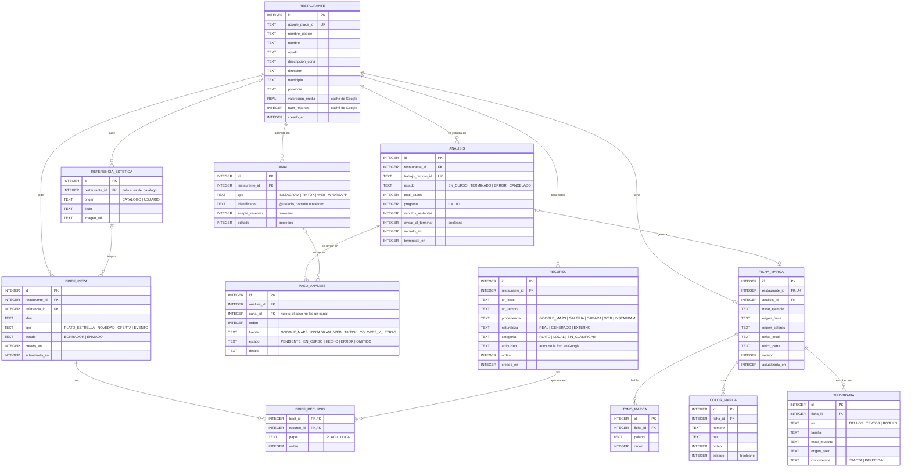

<!-- society-document -->
> **Estado:** vigente · diseño, no implementado. **Fecha de revisión:** 2026-10-12.
> **Ámbito / a quién obliga:** base de datos local (Room) de la app móvil en Kotlin, limitada a cuatro pantallas del boceto: búsqueda del local, estudio del local, ficha del local y creación de una pieza.
> **Fuentes:** capturas de los bocetos facilitadas por Víctor el 2026-10-12. Los valores de ejemplo salen de esas capturas; lo que no se ve en ellas va marcado como *no verificado*.
> **Índice único y autoridad:** [README raíz](../README.md).

# Society — Modelo entidad-relación de la app móvil (pantallas de alta y primera pieza)

## 1 Alcance

El modelo cubre **solo lo que aparece en estas cuatro pantallas**:

| # | Pantalla | Qué guarda |
|---|---|---|
| 1 | **Empezamos** · «Busca tu local en Google Maps» | El local elegido con «Es mi local» |
| 2 | **Estudiando tu local** · paso 3 de 6 | El análisis en curso y el estado de cada fuente |
| 3 | **Ficha del local** · «Ficha guardada en tu perfil» | Canales, forma de hablar, colores, letras y rasgos únicos |
| 4 | **Tu idea** · fotos de platos, del local y referencia estética | El brief de una pieza y las fotos que usa |

Se mantienen los nombres de entidad del [README §8.1](../README.md#81-modelo-de-datos-entidades-principales) cuando hay equivalente: *Restaurante*, *Recurso*, *Brief de pieza*. Usuarios, planes, suscripciones, producción, publicación y métricas quedan fuera porque no salen en estas pantallas.

**Contradicción registrada.** El README (§8) propone la interfaz como web en React + TypeScript o Angular. Este encargo habla de una app móvil en Kotlin con base de datos local. Hasta que Víctor registre el cambio en el README §14, las dos cosas conviven sin decisión.

## 2 Diagrama

## 3 Entidades

En todas las tablas: claves numéricas autogeneradas, fechas como `INTEGER` en milisegundos desde época, booleanos como `INTEGER` 0/1 y enumerados como `TEXT`.

### 3.1 RESTAURANTE · pantallas 1 y 3

Un registro por local. Se crea al pulsar **«Es mi local»**. Todo local sale de Google Maps: no se añade a mano.

| Atributo | Nulo | De dónde sale | Ejemplo del boceto |
|---|---|---|---|
| `google_place_id` | no | Identificador del resultado de Google Maps | — |
| `nombre_google` | sí | Título del resultado | Restaurante Torre de Vega «El Mora» |
| `nombre`, `apodo` | no / sí | Cabecera de la ficha, editables | Torre de Vega · «El Mora» |
| `descripcion_corta` | sí | Subtítulo de la ficha | Asador familiar en La Alquería |
| `direccion`, `municipio`, `provincia` | no | Resultado de búsqueda | Plaza Santa Ana, 8 · Alhaurín de la Torre · Málaga |
| `valoracion_media`, `num_resenas` | sí | Google Maps | 4,8 · 1.695 |

Los **resultados de búsqueda no se guardan**: viven en memoria mientras la pantalla está abierta. Solo el elegido pasa a la tabla. El segundo resultado del boceto («Restaurante Casa Pepe») es relleno, como indica la propia pantalla.

### 3.2 RECURSO · pantallas 1 y 4

Cada foto del local o de un plato. Las imágenes van en el almacenamiento interno de la app y la tabla guarda solo la ruta (`uri_local`), nunca la imagen en `BLOB`.

- `procedencia` dice de dónde vino el archivo: el carrusel de Google Maps de la pantalla 1, la galería o la cámara de la pantalla 4, o la web e Instagram durante el análisis.
- `naturaleza` es la etiqueta del README §6 (real, generado o externo). Las fotos de Google Maps las sube cualquiera, no el restaurante: entran como `EXTERNO` hasta que el propietario confirme que son suyas.
- `categoria` separa «Fotos de tus platos» de «Fotos de tu local». Las de Google llegan como `SIN_CLASIFICAR`, porque el carrusel mezcla sala, terraza y platos.

### 3.3 CANAL · pantallas 2 y 3 («Dónde te encuentran»)

Una fila por perfil o vía de contacto: Instagram `@restaurantetorredevega`, TikTok `@restaurante_torredevega`, web `restaurantetorredevega.es`.

La línea **«Reservas: WhatsApp y formulario web»** no es un canal aparte. Se obtiene de los canales con `acepta_reservas = 1`: el de WhatsApp y el de la web. Así, al editar la web, no queda una copia desactualizada en otra columna.

`editado` vale 0 cuando el dato lo encontró el análisis y pasa a 1 cuando el propietario lo cambia con el lápiz. Sirve para que, si el análisis se repite, no pise lo que el propietario corrigió. COLOR_MARCA lleva el mismo campo.

### 3.4 ANALISIS y PASO_ANALISIS · pantalla 2

El estudio corre en el servidor («Puedes cerrar la app. Seguimos trabajando.»), así que la tabla local es un **espejo del trabajo remoto**:

- `trabajo_remoto_id` enlaza con el trabajo del servidor. Al volver a abrir la app se consulta su estado y no se lanza otro.
- `progreso` (46 %) y `minutos_restantes` (4) los manda el servidor.
- `avisar_al_terminar` se activa con «Avisarme cuando termine».
- El «paso 3 de 6» no se guarda: es la cantidad de pasos `HECHO` más uno, sobre `total_pasos`.

Cada paso guarda su `fuente`, su `estado` (los «HECHO» y «AHORA» del boceto) y un `detalle` libre: «1.695 reseñas leídas» o «Leyendo la carta». Si el paso lee un perfil, `canal_id` lo apunta y la pantalla muestra el `@usuario` desde CANAL.

*No verificado:* el boceto enseña cinco pasos de seis. El sexto no se ve; el enumerado `fuente` tendrá que ampliarse cuando se defina.

### 3.5 FICHA_MARCA y sus listas · pantalla 3

Relación 1:1 con RESTAURANTE (`restaurante_id` único). Guarda qué análisis la generó y una `version` que sube con cada edición, en línea con el principio de preferencias versionadas del [flujo §2](Society_flujo_de_la_aplicacion.md#2-principios-del-flujo).

| Bloque del boceto | Dónde se guarda |
|---|---|
| **Cómo hablas** · Cercano · Tradicional · Apetitoso | TONO_MARCA, una fila por palabra con su `orden` |
| «La calidad se nota en cada plato» · *Así escribes en tu Instagram* | `frase_ejemplo` y `origen_frase` en FICHA_MARCA |
| **Tus colores** · Dorado, Azul rótulo, Ladrillo, Pino, Carbón | COLOR_MARCA, con `nombre` y `hex` |
| *Sacados de tu web, del rótulo de la entrada y de tu sala* | `origen_colores` en FICHA_MARCA (una sola frase para toda la paleta) |
| **Tus letras** · títulos, textos y rótulo | TIPOGRAFIA, una fila por `rol` (único por ficha) |
| *Parecida a la de tu rótulo* | `coincidencia = PARECIDA` + `origen_texto` |
| **Lo que te hace único** · Tu local / En la carta | `unico_local` y `unico_carta` en FICHA_MARCA |

`unico_local` y `unico_carta` son columnas porque el boceto tiene exactamente esas dos etiquetas fijas. Si en el futuro hay más rasgos, se pasan a una tabla propia.

TIPOGRAFIA.`familia` admite nulo: el boceto muestra la letra pero no su nombre, y una tipografía de un rótulo físico puede no tener equivalente exacto.

### 3.6 BRIEF_PIEZA, BRIEF_RECURSO y REFERENCIA_ESTETICA · pantalla 4

- **BRIEF_PIEZA** guarda **Tu idea** (`idea`) y el chip elegido (`tipo`). El texto «Pulpo a la brasa directo de Galicia…» es un ejemplo dentro del campo, no un dato.
- **BRIEF_RECURSO** es la tabla intermedia N:M entre el brief y las fotos. Una misma foto del local (la terraza traída de Google Maps) puede usarse en varias piezas, y una pieza usa varias fotos. `papel` indica en qué bloque está (platos o local) y `orden` respeta el orden de los huecos.
- **REFERENCIA_ESTETICA** reúne las del catálogo de Society («Promo burgers», «Hoy toca sushi») y las que sube el propietario con «Añadir foto». El boceto dice «elige **un** post», así que cada brief tiene como mucho una referencia (`referencia_id` admite nulo).

Una referencia subida por el usuario **no** es un RECURSO: es un post ajeno que sirve de inspiración, no material del local. Mantenerla aparte evita que acabe usándose como foto del restaurante.

## 4 Relaciones y borrado

| Relación | Cardinalidad | Al borrar el padre |
|---|---|---|
| RESTAURANTE → RECURSO, CANAL, ANALISIS, BRIEF_PIEZA | 1:N | En cascada |
| RESTAURANTE → FICHA_MARCA | 1:0..1 | En cascada |
| ANALISIS → PASO_ANALISIS | 1:N | En cascada |
| ANALISIS → FICHA_MARCA | 0..1:0..1 | Poner a nulo (la ficha sigue valiendo) |
| CANAL → PASO_ANALISIS | 0..1:N | Poner a nulo |
| FICHA_MARCA → TONO_MARCA, COLOR_MARCA, TIPOGRAFIA | 1:N | En cascada |
| BRIEF_PIEZA ↔ RECURSO (vía BRIEF_RECURSO) | N:M | En cascada en ambos lados |
| REFERENCIA_ESTETICA → BRIEF_PIEZA | 0..1:N | Poner a nulo |
| RESTAURANTE → REFERENCIA_ESTETICA | 0..1:N | En cascada (solo las subidas) |

## 5 Notas para pasarlo a Room

Orientación, no código: la implementación la hace Víctor.

1. **Índice en cada clave foránea.** Room avisa en compilación si una columna FK no tiene índice, y sin él cada borrado en cascada recorre la tabla hija entera.
2. **Unicidad:** `google_place_id`, `trabajo_remoto_id`, `FICHA_MARCA.restaurante_id`, `(analisis_id, orden)` en PASO_ANALISIS y `(ficha_id, rol)` en TIPOGRAFIA.
3. **Enumerados como texto** con conversor de tipos, no como ordinal: si se reordena el enum, los datos antiguos no cambian de significado.
4. **Lectura de la ficha completa** con una clase de relación que junte FICHA_MARCA con sus tres listas; la tabla N:M se lee con una relación a través de BRIEF_RECURSO.
5. **Pantalla 2 reactiva:** observar ANALISIS y sus pasos con un flujo de la base de datos. El trabajo en segundo plano escribe en la tabla y la pantalla se actualiza sola, aunque se haya cerrado y vuelto a abrir.

## 6 Pendiente de decidir

| Tema | Por qué importa |
|---|---|
| **Sincronización con Supabase** | El README pone Supabase como base de datos central. Si Room es una caché, cada tabla necesita `remoto_id` y una marca de pendiente de subir. Las pantallas no lo muestran, así que no se ha añadido. |
| **Datos de Google en local** | *No verificado en esta revisión:* los términos de Google Maps Platform suelen limitar qué contenido de Places se puede guardar, salvo el `place_id`. Valoración, número de reseñas y fotos están marcados como caché de Google; hay que leer los términos vigentes antes de decidir si se guardan o se piden cada vez. Las fotos de Places exigen además mostrar la atribución del autor. |
| **Derechos de las fotos de Google Maps** | Son de quien las subió, no del restaurante. Antes de usarlas en una pieza publicada hace falta confirmación del propietario (README §6, «nada inventado» y derechos). |
| **Sexto paso del análisis** | No aparece en el boceto. |
| **Usuario y sesión** | «Ficha guardada en tu perfil» implica una cuenta, pero ninguna de las cuatro pantallas la muestra. |
| **Interfaz web o app Kotlin** | Contradicción con el README §8; ver §1. |
